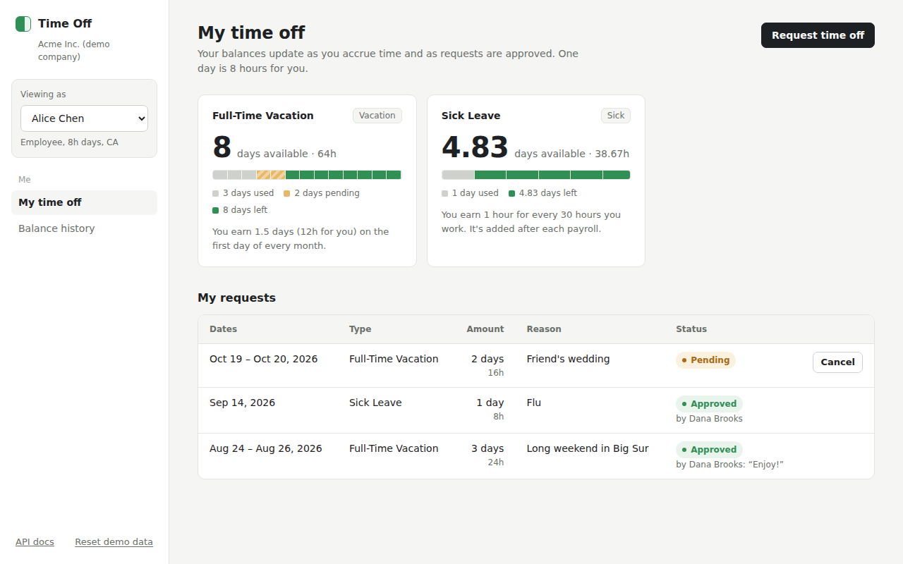

# Employee Time Off Tracking System (take-home assessment)

A design for tracking employee time off, and a working version of it with a
small web UI.

Companies create policies (unlimited, earned over time, or earned per hour
worked) and assign any group of employees to them. Employees see their
balances and request time off. Admins approve or reject. Every balance change
and every policy or request change is recorded.



## What the prompt asked for, and where to find it

**The main task: a time off system**

| Requirement | Where it's designed | Where to see it in the app |
|---|---|---|
| Store policies (unlimited or accrual-based), any grouping of employees | [Data model](docs/03-data-model.md) | Dana: Policies |
| Time-based accrual ("20 days a year") | [Accrual rules](docs/05-accrual-rules.md#time-based-accrual) | Alice: Balance history |
| Hours-worked accrual ("1 hour per 30 worked") | [Accrual rules](docs/05-accrual-rules.md#hours-worked-accrual) | Alice: Balance history, Sick Leave |
| Balances that go up and down | [Data model: the ledger](docs/03-data-model.md#the-ledger-balance_transactions) | Anyone: My time off |
| Employee requests, knowing the balance first | [Core flows](docs/04-core-flows.md) | Anyone: Request time off |
| Admin approvals and balance updates | [Core flows](docs/04-core-flows.md) | Dana: Approvals |
| Changing a policy, negative balances, joining mid-period | [Edge cases](docs/06-edge-cases.md) | Dana: Policies, Edit policy |
| Auditable | [Reliability and audit](docs/07-reliability-and-audit.md) | Dana: Audit log |

**The existing services** (given by the prompt; small simulated versions are included so the demo works end to end)

| Service | Where it's designed | Where to see it |
|---|---|---|
| Employee Service: employees, pay rates, work configuration | [Architecture](docs/02-architecture.md#the-existing-services) | Dana: People |
| Company Service: company information | [Architecture](docs/02-architecture.md#the-existing-services) | Dana: People |
| Payroll Service and `on_payroll_processed` | [Architecture](docs/02-architecture.md#payroll-and-time-off-depend-on-each-other) | Dana: Payroll |

**Bonus challenges:** custom work hours, holidays, carryover and expiration,
tenure. All four are designed and built; see
[Edge cases](docs/06-edge-cases.md#bonus-challenges).

## The design documents

Read in order. Each has diagrams and worked examples with real numbers.

1. [Requirements and scope](docs/01-requirements.md)
2. [Architecture](docs/02-architecture.md), including the existing services and the payroll event
3. [Data model](docs/03-data-model.md), and why balances are a ledger
4. [Core flows](docs/04-core-flows.md): request, approve, cancel, change a policy, holidays, payroll
5. [Accrual rules](docs/05-accrual-rules.md): the math, with examples
6. [Edge cases](docs/06-edge-cases.md): the prompt's three questions, bonus challenges
7. [Reliability and audit](docs/07-reliability-and-audit.md)
8. [Tradeoffs and next steps](docs/08-tradeoffs-and-next-steps.md)

Also:
- [Glossary](docs/glossary.md): every technical word in plain language
- [Code tour](docs/code-tour.md): what each folder does, and one click followed through the code
- Production database schema: [`schema.sql`](schema.sql)

## The main ideas in 30 seconds

- **Balances are a ledger.** Every change is a row (earned, reserved, taken,
  expired...), and a balance is the sum. Any balance can be explained line by
  line, and mistakes are fixed by adding a row, never by editing one.
- **Policies are versioned.** Changing a policy creates a new version from a
  date. Past balances never change.
- **Everything is stored in minutes.** A "day" is converted with each
  person's own workday, so 6-hour and 8-hour employees share the same policies.
- **Nothing is counted twice.** Every ledger row has a unique key, so a job
  that runs twice or a payroll event delivered twice has no extra effect.
- **Pending requests reserve hours**, so nobody can book the same hours twice.
- **Payroll and time off talk both ways.** Payroll asks for approved time off
  (a day off isn't a day worked), then publishes `on_payroll_processed`,
  which Time Off listens to.

## Short answers to the prompt's questions

**Updating a policy's accrual settings?** A new version, effective from a
future date. Old accruals stay linked to the old rules.

**Negative balances?** A per-policy choice, off by default. If allowed, the
admin must set a limit (e.g. 8 hours).

**Joining halfway through a period?** The policy chooses: prorate (default;
joining July 1 on 20 days a year gives 10.08 days), full amount, or start next
period.

## Run it

You need **Python 3.10 or newer**. No database or Node needed.

```bash
./run.sh        # macOS / Linux
run.bat         # Windows
```

Then open **http://localhost:8000**. The API docs are at
http://localhost:8000/docs.

Other options:

```bash
# manually
python -m venv .venv
source .venv/bin/activate          # Windows: .venv\Scripts\activate
pip install -r requirements.txt
uvicorn app.main:app --reload

# with Docker
docker compose up --build

# tests (83, under a second)
pytest
```

The app starts with a demo company built around today's date. Data is kept in
memory, and **Reset demo data** in the sidebar starts over.

## Trying it out

Use **Viewing as** in the sidebar to switch between people:

| Person | Why they're interesting |
|---|---|
| Alice Chen | Full-time, 5+ years at the company, so she earns the higher tenure rate |
| Bob Rivera | Part-time, 6-hour days, joined in July |
| Priya Shah | On an unlimited policy |
| Marco Diaz | Contractor, on an unpaid time off policy |
| Dana Brooks | Admin: approvals, policies, holidays, people, payroll, audit log |

A short walkthrough:

1. **Alice, My time off.** Each card says how the balance is earned.
2. **Request time off** from Dec 23 to Dec 28. It costs 3 days, not 6:
   Christmas and the weekend are skipped. Try "Part of a day" too.
3. **Alice, Balance history.** Every change, with the math in the Details column.
4. **Dana, Approvals.** Approve with a note, or reject. Revoking approved time
   off needs a reason.
5. **Dana, Policies.** Edit a policy: it saves as a new version. **Audit log**
   shows exactly what changed, old value in red and new in green.
6. **Dana, People.** The data from the Employee and Company Services.
7. **Dana, Payroll.** Hours worked for each person (scheduled, minus holidays
   and time off) and paid hours (holidays and paid time off are paid, just not
   worked). Change Alice's hours and click **Re-run payroll**: Time Off
   receives `on_payroll_processed` and adds only the difference to her sick
   leave.

## Project structure

```
├── README.md
├── docs/                    design documents (read in order), diagrams, screenshots
├── schema.sql               production PostgreSQL schema
├── app/
│   ├── main.py              API routes, permissions, serves the UI
│   ├── domain/              the Time Off Service: all business rules
│   │   ├── ledger.py            the only place balances change
│   │   ├── policies.py          policies, versions, assignments
│   │   ├── accrual.py           time-based and hours-worked accrual
│   │   ├── time_off_requests.py requests, approvals, cancellations
│   │   ├── holidays.py          holidays and refunds
│   │   ├── year_end.py          carryover and expiration
│   │   └── balances.py          balance summaries for the UI
│   ├── external/            simulated existing services
│   │   ├── employee_service.py
│   │   ├── company_service.py
│   │   ├── payroll_service.py
│   │   └── events.py            on_payroll_processed and a small event bus
│   ├── storage/memory.py    in-memory store with the same shape as schema.sql
│   ├── static/              the web UI (plain HTML, CSS, JavaScript)
│   └── demo_data.py         the demo company
├── tests/                   83 tests
├── run.sh, run.bat          one-command start
└── Dockerfile, docker-compose.yml
```

## What's simplified for the take-home

- **Storage is in memory**, so it runs anywhere in seconds. The business rules
  don't touch the database directly, so switching to Postgres only changes
  `app/storage/`.
- **The existing services are simulated.** Pay uses flat demo rates, and the
  event bus is in-process instead of a real queue.
- **No real login.** "Viewing as" stands in for it, but the API still checks
  permissions (non-admins get a 403).
- **The UI is plain JavaScript** served by the backend, with no build step.
