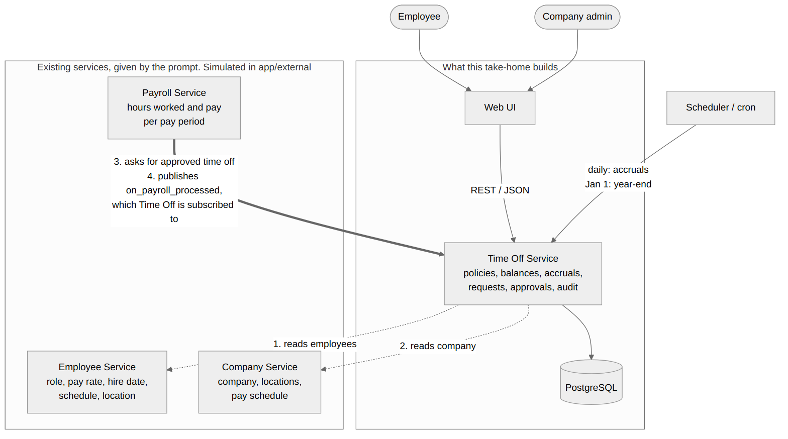
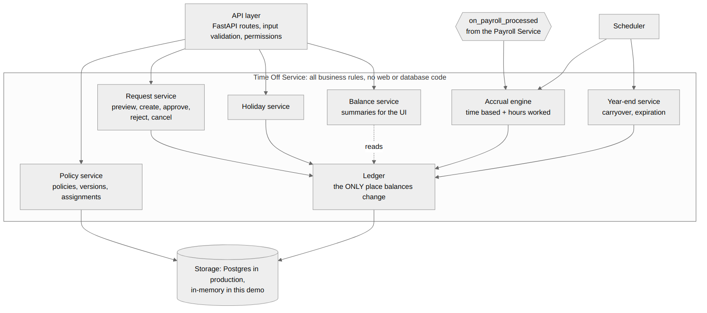
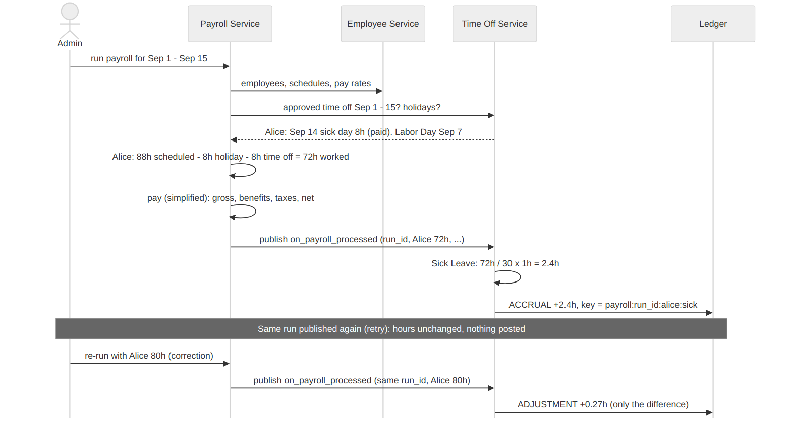
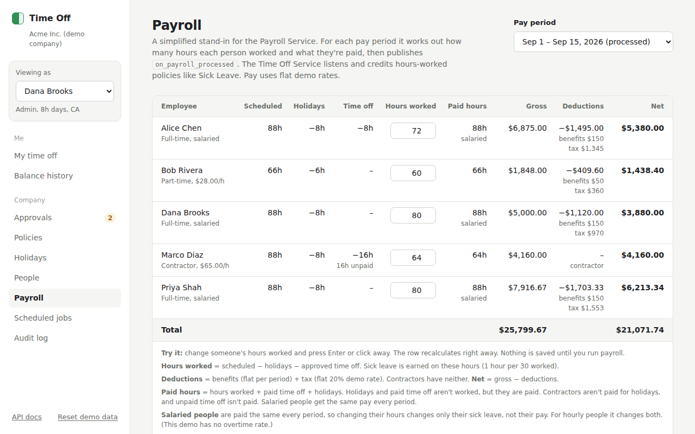

# 2. Architecture

## The big picture

The Time Off Service is **one backend service with one database**. It works
with three services that the prompt says already exist (Employee, Company,
Payroll), and one simple piece of infrastructure: a **scheduler** (cron) that
runs the accrual job every day and the year-end job on January 1.

## Inside the service

I split the code into three layers:

1. **API layer** (`app/main.py`). Parses the request, checks permissions,
   calls the domain, returns JSON. No business rules here.
2. **Domain layer** (`app/domain/`). All the rules: accruals, requests,
   holidays, year-end. Plain Python, no web framework or database code, which
   is why the 83 tests run in under a second.
3. **Storage** (`app/storage/`). In this demo it's in memory so the project
   runs with one command. In production it's PostgreSQL with the schema in
   [`schema.sql`](../schema.sql). Only this layer would change.

The most important rule in the whole design: **the Ledger is the only code
that changes a balance.** Requests, accruals, holidays and year-end all
describe their effect as ledger entries. There's no second place where a
balance could drift.

## The existing services

The prompt gives these to us. In a real company they belong to other teams.
For the demo I built small simulated versions in `app/external/`, kept apart
from the Time Off code, so the Time Off Service talks to them only through a
few methods and one event, the same as it would with the real ones.

| Service | What it has | What Time Off uses | Code |
|---|---|---|---|
| **Employee Service** | Name, title, department, full-time / part-time / contractor, hourly or salary and pay rate, hours per day, work days, location, hire and termination dates | Hire date (tenure, waiting period, proration), hours per day (a "day"), work days (skip weekends), location (holidays), termination (stop accruing) | `employee_service.py` |
| **Company Service** | Name, locations, pay schedule, work week, time zone | Company exists, which locations are valid for holidays | `company_service.py` |
| **Payroll Service** | Pay runs: hours and pay per employee per period | The `on_payroll_processed` event | `payroll_service.py` |

The demo company is "Acme Inc." with five people: three full-time, one
part-time with 6-hour days, and one contractor. Admins can see all of this
on the **People** page.

### Payroll and time off depend on each other

When an admin runs payroll for a period (the **Payroll** page):

1. Payroll gets everyone employed during the period from the Employee Service.
2. It **asks Time Off** for approved time off in the period
   (`GET /employees/{id}/approved-time-off`) and uses the company holidays.
3. It works out hours worked:
   `scheduled hours − holidays − approved time off`.
   Example: Alice, Sep 1-15: 88h scheduled − 8h Labor Day − 8h sick day = **72h**.
4. It works out **paid hours**, which is a different number:
   `hours worked + paid time off + holidays`. A holiday isn't worked, but it
   is paid. So Bob (6-hour days) worked 60h in Sep 1-15 but is paid for 66h,
   because Labor Day is paid. Contractors aren't paid for holidays, and unpaid
   time off isn't paid.
5. It calculates simplified pay. Hourly people get `paid hours x rate`.
   Salaried people get the same amount every period, so for them paid hours
   are simply their normal schedule: if an admin enters extra hours for Alice,
   she earns a bit more sick leave but the same pay (no overtime, as for most
   salaried US employees). Deductions are a flat benefits amount plus a flat
   20% tax. Contractors have no deductions.
6. It **publishes `on_payroll_processed`** with each employee's hours worked.
7. Time Off is **subscribed**: the accrual engine credits hours-worked
   policies, e.g. Sick Leave: 72h / 30 = **2.4h**.

**Why two numbers?** Sick leave is earned per hour **worked** (that's how
laws like California's work), while pay is based on hours **paid**. Mixing
them up would either give sick leave for days nobody worked, or not pay people
for holidays.

This is what the admin sees on the Payroll page:

Running payroll again for the same period keeps the same run id. That's how a
correction works: Time Off sees the same run with different hours and posts
only the difference.

**Keeping payroll up to date.** If time off in a period changes after that
period was processed (for example, an admin approves a sick day someone forgot
to log), the payroll run is now out of date. The Payroll page checks this and
shows **"Needs re-run"**. Re-running fixes both the hours and the sick leave.

**Why an event and not a direct call?** Payroll shouldn't need to know which
services care that payroll finished. With an event, Time Off (and later,
maybe benefits or reporting) subscribes without Payroll changing. In the demo
the "event bus" is a few lines of in-process publish/subscribe
(`app/external/events.py`). In production it would be a queue such as SQS,
which also gives retries if Time Off is down when the event is published.

## Why one service and not microservices

I thought about splitting policies, requests and balances into separate
services. I didn't, because:

- Approving a request has to update the request, the balance and the audit
  log **together**. In one database that's one transaction. Across services it
  becomes a distributed transaction problem (sagas, compensation) for no real
  benefit.
- The load is small. Even a big customer creates a few requests a day.
- A small team can run, debug and deploy one service easily.

If one part ever needs to scale on its own, the domain modules already have
clear boundaries, so pulling one out later is straightforward.

## How the integrations work

**Payroll event.** Described above. The handler is idempotent (the payroll
`run_id` is part of the key), so a message delivered twice is harmless. See
[Reliability](07-reliability-and-audit.md).

**Scheduler.** A daily cron job calls "run accruals up to today". The job
works out everything that's due and skips anything already posted, so if it
misses a day, the next run catches up. Year-end runs on January 1.

**Employee Service.** Read on demand. If it's down, requests that need
employee data fail with a clear error and can be retried. Accrual jobs just
run again the next day.

## Technology choices

I kept these deliberately boring:

| Choice | Why |
|---|---|
| Python + FastAPI | Quick to write, automatic API docs at `/docs`, easy to read |
| PostgreSQL | Transactions, unique constraints for idempotency, `SELECT ... FOR UPDATE` for concurrency |
| Cron / scheduler | Accruals only need to run once a day |
| A queue for payroll events | Retries and a dead-letter queue if processing fails |
| Plain JavaScript UI | Served by FastAPI, no build step. For the real product I'd use React + TypeScript |

## API overview

| Area | Endpoints |
|---|---|
| Company Service (simulated) | `GET /companies`, `GET /companies/{id}` |
| Employee Service (simulated) | `GET /employees`, `GET /employees/{id}` |
| Payroll Service (simulated) | `GET /payroll/periods`, `POST /payroll/preview`, `POST /payroll/runs` (admin), `GET /payroll/runs`, `GET /events` |
| Time off for payroll | `GET /employees/{id}/approved-time-off?start=&end=` |
| Policies (admin) | `POST /policies`, `PATCH /policies/{id}` (new version), `POST /policies/{id}/assignments`, `POST /assignments/{id}/end` |
| Balances | `GET /employees/{id}/balances`, `GET /employees/{id}/policies/{pid}/transactions` |
| Requests | `POST /time-off-requests/preview`, `POST /time-off-requests`, `.../approve`, `.../reject`, `.../cancel` |
| Holidays (admin) | `GET /holidays`, `POST /holidays` |
| Jobs and events | `POST /jobs/run-accruals`, `POST /jobs/year-end`, `POST /events/payroll-processed` |
| Audit | `GET /audit-log` |

Full interactive docs are at `http://localhost:8000/docs` when the app runs.
Errors always look like `{"error": "...", "detail": "..."}` with 400
(invalid input), 403 (not allowed), 404 (not found), 409 (wrong state, e.g.
approving a rejected request) or 422 (not enough balance).
