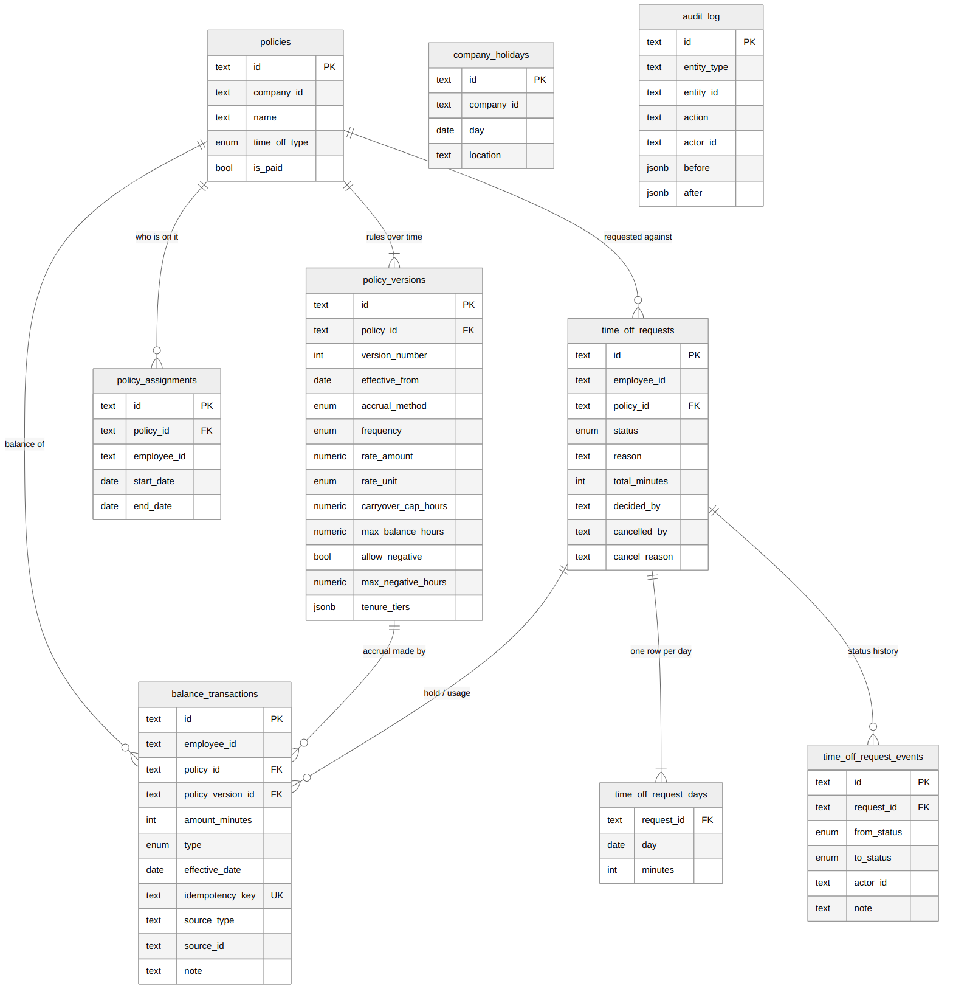

# 3. Data model

Full SQL: [`schema.sql`](../schema.sql).



## The three ideas behind the model

**1. Balances are a ledger, not a number.** There is no `balance` column
anywhere. Every change is a row in `balance_transactions`, and a balance is
`SUM(amount_minutes)`. It's how a bank account works.

**2. Policy rules are versioned.** `policies` holds the name and type.
The rules (rate, caps, etc.) live in `policy_versions`, and each version has
an `effective_from` date. Versions are never edited.

**3. Everything is stored in minutes.** Policies are set up in days or hours,
but a "day" means different things for different people (8h vs 6h). Storing
minutes as whole numbers is exact and works for every schedule.

## Tables

### `policies`
The identity of a policy: company, name, type (vacation, sick...), paid or
unpaid. The rules are in `policy_versions`.

### `policy_versions`
The rules, starting on `effective_from`:
- `accrual_method`: `unlimited`, `time_based` or `hours_worked`
- `frequency` and `accrue_at`: monthly or yearly, start or end of the period
- `rate_amount` and `rate_unit`: for example 1.25 days
- `hours_worked_per_accrual`: the "30" in "1 hour per 30 hours worked"
- `max_balance_hours`: stop accruing above this
- `carryover_cap_hours`: how much survives year-end (empty means everything)
- `allow_negative` and `max_negative_hours`
- `proration_rule` and `waiting_period_days`: for new joiners
- `tenure_tiers`: JSON like `[{"min_years": 5, "rate_amount": 1.5}]`

Constraints in the database stop invalid combinations, for example a
time-based policy without a frequency, or `allow_negative` without a limit.

### `policy_assignments`
Who is on which policy, and for which dates (`start_date`, `end_date`).
This is how "any grouping" works: full-time vs part-time is just two policies
with different people assigned. The dates let someone move from part-time to
full-time on June 1 while keeping their history. An employee can only be on
one policy **per type** at a time, otherwise we wouldn't know which vacation
balance to use.

### The ledger: `balance_transactions`

The most important table. Each row is one change:

| Column | Meaning |
|---|---|
| `amount_minutes` | Positive adds, negative removes |
| `type` | `accrual`, `hold`, `hold_release`, `usage`, `usage_reversal`, `expiration`, `adjustment` |
| `effective_date` | The day it applies to (the time off date, the accrual date) |
| `idempotency_key` | **UNIQUE.** Stops the same change being recorded twice |
| `source_type`, `source_id` | What caused it: a request, a payroll run, an accrual period, a year-end run |
| `policy_version_id` | Which rules produced it |
| `note` | Human-readable, e.g. "88h worked / 30 x 1h = 2.93h" |
| `created_by`, `created_at` | Who and when |

Alice's vacation ledger looks like this (newest last):

| Date | Type | Amount | Balance | Note |
|---|---|---|---|---|
| Jan 1 | accrual | +10h | 10h | January 2026: 1.25 days x 8h = 10h |
| Feb 1 | accrual | +10h | 20h | February 2026: 1.25 days x 8h = 10h |
| Mar 1 | accrual | +12h | 32h | March 2026: 1.5 days x 8h = 12h (rate after 5 years) |
| ... | | | | |
| Aug 24 | hold | −24h | (92h) | Reserved while the request is pending |
| Aug 24 | hold_release | +24h | (92h) | Approved: replaced by the time off taken |
| Aug 24 | usage | −24h | 68h | Time off Aug 24 - Aug 26, 2026 |

Three balances come out of this table:

```
balance   = SUM of everything except holds       (what she has)
pending   = SUM of holds, flipped to positive    (reserved by pending requests)
available = balance - pending                    (what she can still request)
```

**Why not just a `balance` column?** A column tells you the number, but not
why. When an employee says "my balance is wrong", a ledger lets you show every
change. It also makes corrections safe: to undo something you add a reversing
row instead of editing history, like a bank refund.

### `balance_snapshots` (production only)
Summing a few hundred rows per employee is fast, but an admin screen with
every employee would do this many times. The snapshot stores the current sum
and is updated **in the same transaction** as each ledger insert. It's a
cache: it can always be rebuilt from the ledger. It's also the row we lock
to stop two requests racing (see [Reliability](07-reliability-and-audit.md)).

### `time_off_requests` and `time_off_request_days`
A request has a status, a reason, and who decided or cancelled it and why.
Each counted working day is a row in `time_off_request_days` with its minutes.
Weekends and holidays aren't stored because they don't cost anything. This
makes partial days simple (one row with 240 minutes) and makes holiday refunds
simple (set one day's minutes to 0).

### `time_off_request_events`
Every status change of a request: from, to, who, note. This is the request's
history.

### `company_holidays`
Company, date, name, and an optional `location` for state-specific holidays
(e.g. a California-only holiday).

### `audit_log`
A general record for everything admins do: policy created or changed,
assignments, holidays, request decisions. It stores `before` and `after` as
JSON, which is how the UI can show "Carryover: Up to 40h → Up to 80h".

## Data the Time Off Service does not own

Employees and companies live in the Employee and Company Services. Time Off
stores only their ids (`employee_id`, `company_id`) and reads the rest when it
needs it. That means no copies to keep in sync. The trade-off is that if an
employee's hours per day change, the new value is used from then on; past
ledger rows already have the amounts calculated with the old value, and the
inputs are saved in each row's metadata.

Payroll runs are stored by the (simulated) Payroll Service itself, not in the
Time Off database. Time Off only records what a run caused: ledger rows with
`source_type = payroll_run` and `source_id = run id`.

## Why minutes as whole numbers

- 6-hour days, partial days and accruals like 2.93h all need fractions.
- Floating point numbers slowly drift when you add them up thousands of times.
  Integers don't.
- Rounding happens once, when an accrual is calculated, and the inputs are
  saved in the row's metadata so the number can always be re-checked.

## Indexes

| Index | For |
|---|---|
| `balance_transactions (employee_id, policy_id, effective_date)` | Balance and history |
| `balance_transactions (source_type, source_id)` | "What did this request / payroll run do?" |
| `UNIQUE (idempotency_key)` | No duplicates, enforced by the database |
| `time_off_requests (employee_id, start_date)` | Overlap checks, "my requests" |
| `audit_log (entity_type, entity_id, created_at)` | History of one policy or request |
