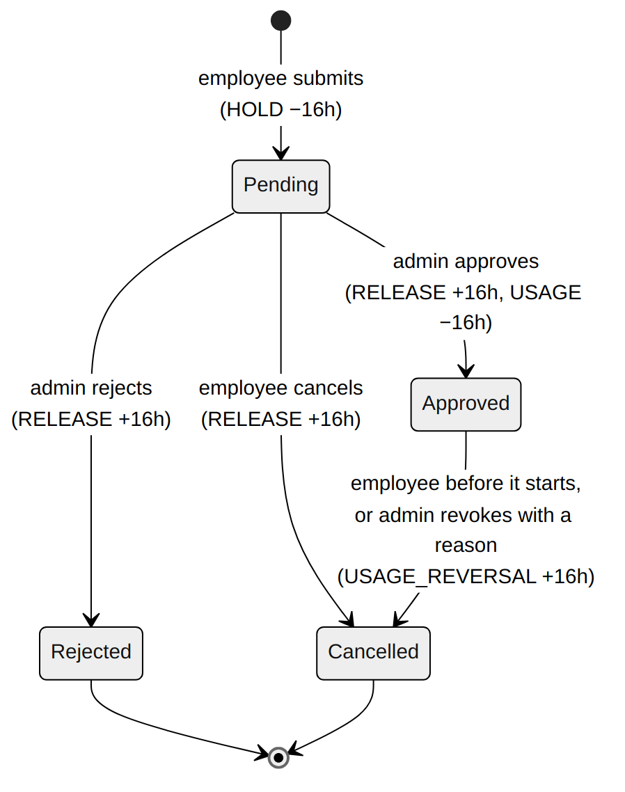
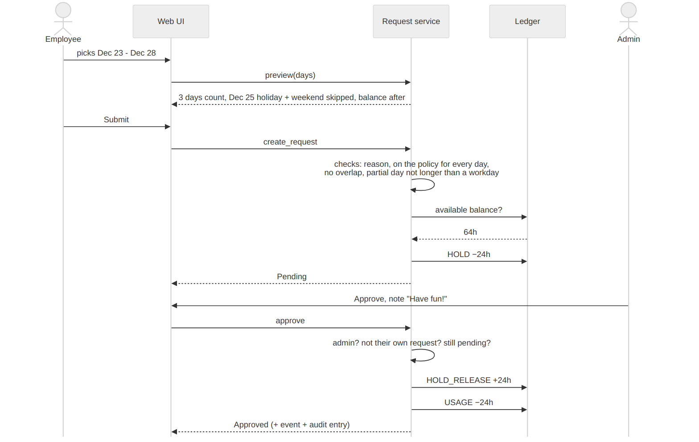
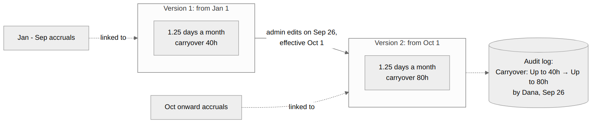
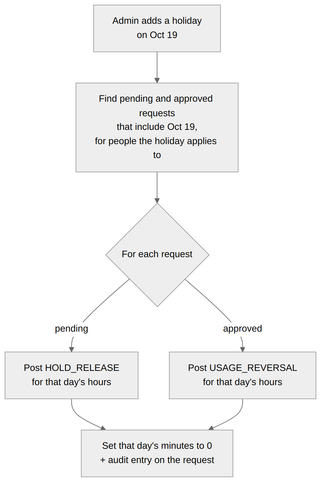

# 4. Core flows

## Request lifecycle

A request can only move along these arrows. Anything else (approving a
rejected request, approving twice) is refused with a 409.

| Action | Who | Balance effect |
|---|---|---|
| Submit | Employee | `HOLD` reserves the hours |
| Approve (optional note) | Admin, not for their own request | `HOLD_RELEASE` + `USAGE` |
| Reject (optional note) | Admin | `HOLD_RELEASE` |
| Cancel a pending request (optional reason) | Employee | `HOLD_RELEASE` |
| Cancel approved time off before it starts (optional reason) | Employee | `USAGE_REVERSAL` |
| Revoke approved time off (**reason required**) | Admin | `USAGE_REVERSAL` |

**Why admins can revoke approved time off.** It sounds odd at first, but
real companies need it: the employee's trip got cancelled and they came to
work, it was approved by mistake, or the person left the company before their
time off. I require a reason so it's never silent. The employee sees it next
to the request and it's in the audit log.

## Requesting and approving time off

**Step by step:**

1. The employee picks **full day(s)** (a date range) or **part of a day**
   (one date plus a start and end time, e.g. 1:00 PM to 5:00 PM = 4h).
2. The UI calls **preview**, which returns how many hours this costs, which
   days were skipped (weekends, holidays) and the balance afterwards. The
   employee sees this before submitting.
3. On submit, the service checks:
   - there's a reason
   - the employee is on this policy on **every** requested day
   - no overlap with another pending or approved request
   - a partial day isn't longer than their workday
   - the balance is enough (or within the policy's negative limit)
4. It creates the request and posts a **HOLD** for the hours.
5. The admin approves. The hold is released and replaced by **USAGE**.

### Why a hold?

Without it: Alice has 5 days and submits two separate 5-day requests. Each
one looks fine on its own, because nothing has been approved yet. If the
admin approves both, she's at −5 days.

With the hold, the first request reserves 5 days right away. Her
**available** balance is 0, so the second request is refused immediately,
with a clear message, before anyone approves anything.

### How days are counted

| Selected | Alice (8h days) | Bob (6h days) |
|---|---|---|
| Wed Dec 23 to Mon Dec 28 | Dec 23, 24, 28 = **24h** | Same 3 days = **18h** |
| Skipped | Dec 25 (Christmas), Dec 26-27 (weekend) | Same |
| Part of a day, 1 PM to 5 PM | **4h** | **4h** |

A full day costs **that person's** workday length. Weekends come from the
employee's work days in the Employee Service, so someone working Tuesday to
Saturday would be handled correctly too.

## Changing a policy

When an admin edits a policy:

1. They choose when the new rules start (default: the 1st of next month).
2. The new start date must be after the current version's. History can't be
   rewritten by accident.
3. A new version is saved with the changed settings. The old version stays.
4. The audit log records the change in plain words, e.g.
   "Carryover: ~~Up to 40h~~ → Up to 80h, takes effect Oct 1, 2026".

The rules in effect **on the first day of a period** apply to the whole
period. So a change made on Feb 15 applies from the March accrual, and no
month is ever calculated with two sets of rules.

## Adding a holiday after requests exist

Holidays are skipped when a request is created. But what if the company
adds a holiday **after** someone already booked that day off?

The holiday service finds every pending or approved request that includes
that day (for people the holiday applies to, so a CA-only holiday doesn't
affect NY employees) and refunds that day:

- pending request: release that part of the hold
- approved request: post a `USAGE_REVERSAL` for that day

The day's minutes on the request become 0, and there's an audit entry on the
request. The employee doesn't have to do anything.

**Not handled: removing a holiday.** I'd rather not silently charge people
for a day they thought was free. I'd flag the affected requests for an admin
to decide.

## Running payroll

An admin picks a finished pay period on the **Payroll** page. The Payroll
Service shows everyone's scheduled hours, holidays, approved time off and
hours worked, which the admin can adjust (for example for overtime). Running
it publishes `on_payroll_processed`, and Time Off credits sick leave. The full
flow is in [Architecture](02-architecture.md#payroll-and-time-off-depend-on-each-other).

Three rules keep this safe:
- Payroll can't run for a period that hasn't ended yet.
- Running the same period again is a correction: same run id, so Time Off
  posts only the difference.
- If time off or holidays in a processed period change afterwards, the run is
  marked **"Needs re-run"** so the admin knows to update it.

## Accruals

These are described with worked examples in
[Accrual rules](05-accrual-rules.md).
