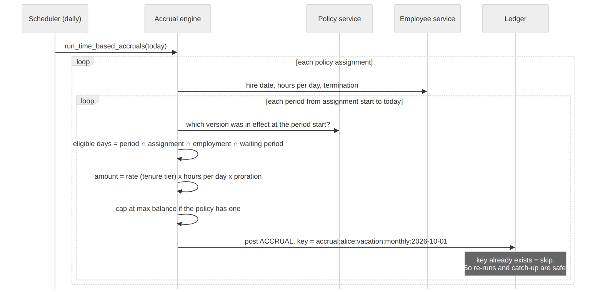
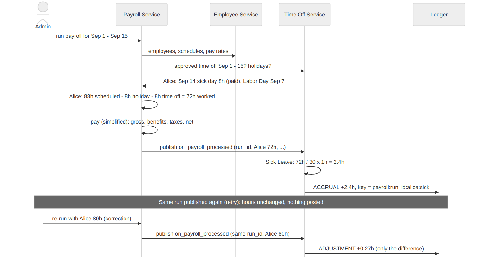
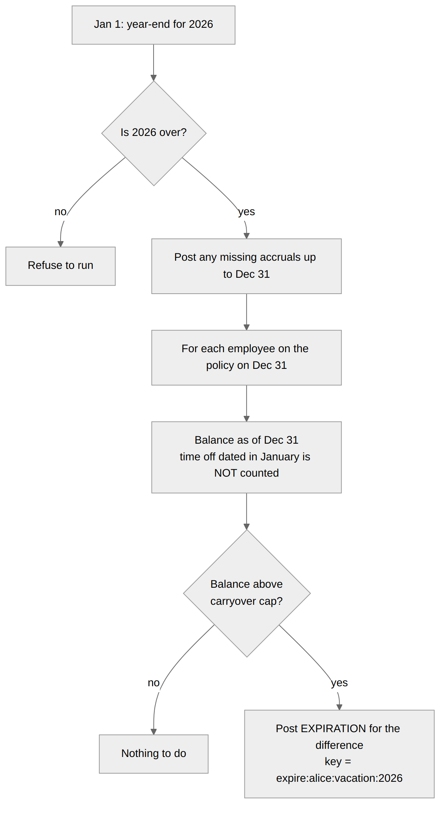

# 5. Accrual rules, with worked examples

This is the part with the most rules, so every example below uses real
numbers from the demo data. You can check each one in the app under
**Balance history**.

The demo people:

| Person | Type | Hired | Workday | Notes |
|---|---|---|---|---|
| Alice Chen | Full-time, CA | Mar 1, 2021 | 8h | Reaches 5 years on Mar 1, 2026 |
| Bob Rivera | Part-time, NY | Jul 1, 2026 | 6h | Joined halfway through the year |
| Priya Shah | Full-time, NY | May 10, 2024 | 8h | On unlimited PTO |
| Marco Diaz | Contractor, CA | Nov 3, 2025 | 8h | On an unpaid contractor policy |
| Dana Brooks | Full-time, CA | Jan 6, 2020 | 8h | Admin |

## One day = your workday

Policies can be written in **days** or **hours**. The ledger always stores
minutes, and a "day" is converted using each person's own workday:

| Policy says | Alice (8h) | Bob (6h) |
|---|---|---|
| 1.25 days a month | 10h | 7.5h |
| 10 hours a month | 10h (1.25 days) | 10h (1.67 days) |
| Request 1 full day | −8h | −6h |

So with a policy in days, both "see" 1.25 days a month and a day off costs
one day. That's usually what companies mean. A policy in hours gives everyone
the same hours instead.

## Time-based accrual

"Earn X every month (or year)." Alice's vacation policy: **1.25 days a
month, 1.5 days after 5 years, credited on the 1st.**



The formula for one period:

```
amount = rate (after tenure) x workday hours x proration
```

Alice, 2026:

| Month | Years at company | Rate | Calculation | Credited |
|---|---|---|---|---|
| January | 4 | 1.25 days | 1.25 x 8h | 10h |
| February | 4 | 1.25 days | 1.25 x 8h | 10h |
| March | **5** | **1.5 days** | 1.5 x 8h | **12h** |
| April to September | 5 | 1.5 days | 1.5 x 8h | 12h each |

By Sep 1 she has earned 10 + 10 + (7 x 12) = **104h**. She took 3 days in
August (−24h), so her balance is **80h** (10 days).

**Start or end of period.** "Start" credits the whole month on the 1st (so on
Sep 26 she already has September's time). "End" credits it on the 30th.
Start is nicer for employees; end is safer for the company, because someone
who leaves mid-month hasn't been given time they didn't work.

**How the job works.** Every day, for every assignment, it walks through
each period from the assignment's start until today and asks: "is this
period's accrual due, and has it been posted?" Each period has a unique key
like `accrual:alice:vacation:monthly:2026-09-01`. If the key exists, it skips
it. That's why running the job twice changes nothing, and why a missed week
is caught up on the next run.

## Hours-worked accrual

"Earn X for every Y hours worked." The Sick Leave policy: **1 hour for every
30 hours worked**. This mirrors laws like California's sick leave minimum.



Payroll runs twice a month (1st to 15th, 16th to end of month). The Payroll
Service works out hours worked, publishes them in `on_payroll_processed`, and
Time Off credits:

```
hours worked = scheduled hours − holidays − approved time off   (Payroll Service)
sick leave   = hours worked / 30 x 1h                           (Time Off Service)
```

Alice's real numbers from the demo:

| Pay period | Scheduled | Minus | Hours worked | Sick leave |
|---|---|---|---|---|
| Feb 16 - 28 | 10 days = 80h | nothing | 80h | 80 / 30 = **2.67h** |
| Jan 1 - 15 | 11 days = 88h | New Year's Day 8h | 80h | 80 / 30 = **2.67h** |
| Mar 16 - 31 | 12 days = 96h | César Chávez Day 8h (CA only) | 88h | 88 / 30 = **2.93h** |
| Sep 1 - 15 | 11 days = 88h | Labor Day 8h, her sick day 8h | 72h | 72 / 30 = **2.4h** |

More hours worked means more sick leave. Unlike vacation, the calendar doesn't
matter, only the hours payroll reports. Taking a day off means that day isn't
worked, so it doesn't earn sick leave, which is how hours-worked accrual
normally works.

Holidays and paid time off still **count for pay**, just not for sick leave.
Payroll keeps two numbers: hours worked (for sick leave) and paid hours (for
pay). Some companies choose to give sick leave on all paid hours instead; that
could be a policy setting ("earn on hours worked" or "earn on paid hours"),
and I listed it as a possible follow-up.

**Same event twice.** The payroll `run_id` is part of the key. If the same
run arrives again (network retry), nothing happens.

**Payroll correction.** If payroll re-processes a run with different hours
(Alice actually worked 80h, not 72h), we don't add the whole amount again.
We add only the difference: 80/30 − 72/30 = **+0.27h**, as an `ADJUSTMENT`.
History is kept: you see the original entry and the correction. You can try
this on the Payroll page by changing her hours and clicking **Re-run payroll**.

## Joining mid-period (proration)

The prompt's example: the policy is **20 days a year** (credited on Jan 1),
and Bob joins on **July 1**. What does he get for 2026?

Each policy chooses:

| Rule | Bob gets for 2026 | Calculation |
|---|---|---|
| **Prorate** (default) | **10.08 days** | 20 x 184/365 (he's there 184 of 365 days) |
| Full amount | 20 days | Joined in the period, gets all of it |
| Start next period | 0 days | Starts earning on Jan 1, 2027 |

For a monthly policy it works the same way: joining on the 15th of a 30-day
month gives 16/30 of that month. Leaving mid-period (termination, or
moving to another policy) is always prorated.

The proration uses **calendar days**, which is simple to explain. Using
working days would be slightly more precise; I noted it as a possible change.

## Waiting period

"New hires start earning after 90 days." The waiting period moves the date
someone becomes eligible:

Bob, hired Jul 1, on a 5 days/month policy with a 90-day wait:

| Month | Earned | Why |
|---|---|---|
| July, August | 0 | Still waiting |
| September | 5 days x 2/30 | Eligible from Sep 29, so 2 of 30 days |
| October | 5 days | Full month |

It counts from the **hire date**, so someone hired years ago is never
affected when a waiting period is added.

## Tenure tiers

"More time off the longer you stay." Alice's policy:

| Years at the company | Rate |
|---|---|
| 0 to 4 | 1.25 days a month |
| 5 and up | 1.5 days a month |

The rate is chosen **on each accrual date**, based on years since hire. Alice
hit 5 years on Mar 1, 2026, so the March accrual is the first at 1.5 days. The
ledger note says "(rate after 5 years)" and the years used are saved with
the entry.

**Limitation:** on a **yearly** policy, someone who reaches 5 years in March
gets the new rate from the next Jan 1. Monthly policies pick it up the next
month. Splitting a period at the anniversary would be a follow-up.

## Caps and limits

| Setting | Example | Effect |
|---|---|---|
| **Max balance** | Sick leave, 80h | Accrual stops at 80h. Using some lets it grow again. The ledger note says "capped". |
| **Carryover cap** | Vacation, 40h | At year-end, anything above 40h expires. |
| **Negative limit** | Sick leave, 8h | You can request up to 8h more than you have. |

Max balance and carryover cap solve the same problem in different ways.
Some states (like California) don't allow earned vacation to expire, so there
a max balance is the legal way to limit how much someone saves up.

## Year-end: carryover and expiration



On January 1, for each policy with a carryover cap:

1. **Refuse** if the year isn't over yet.
2. **Catch up** any missing accruals up to Dec 31, so the year is complete.
3. For each employee on the policy on Dec 31, take the balance **as of Dec 31**.
4. If it's above the cap, post an `EXPIRATION` for the difference.

Example: Alice ends 2026 with 116h and the cap is 40h, so **76h expires** and
she starts 2027 with 40h.

Time off approved for **January** is dated in January, so it doesn't count
against the 2026 balance. It comes out of 2027.

The key `expire:alice:vacation:2026` means year-end can't run twice for the
same year.

## Rounding

Rounding happens once, when an accrual is calculated, to the nearest minute.
Example: 88 / 30 = 2.9333h = 176 minutes. Over a year this can differ from the
"exact" total by a few minutes. That's acceptable, and it's always explainable
because each row's inputs are stored.
